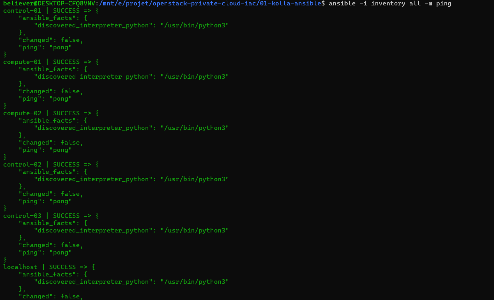
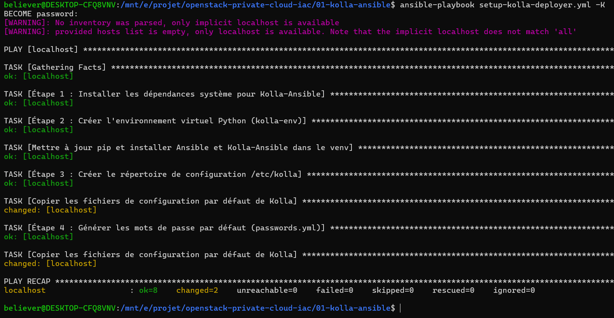
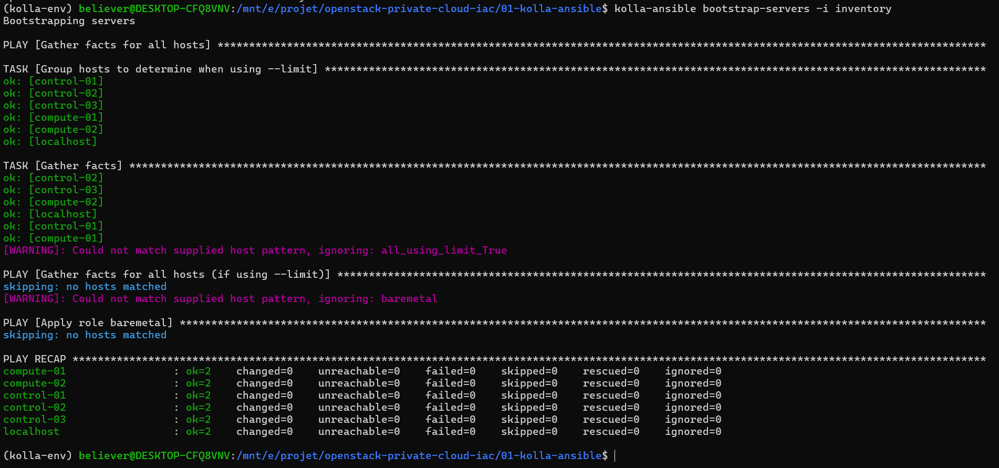
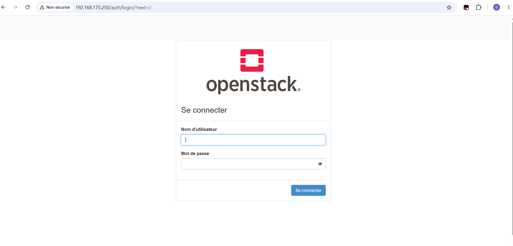
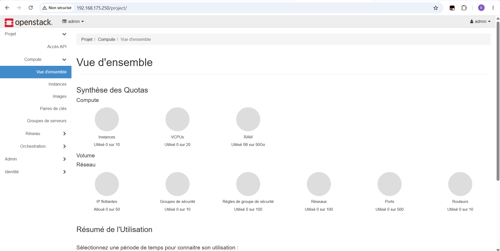

## 1. Première étape :  Environnement de travail

Pour la partie de préparations des machines virtuelles qui vont faire l 'office d'hôte pour **Openstack**, nous avons   préparer un fichier [Vagrantfile](./00-vagrant-lab/Vagrantfile)  qui contient la contigurations  de  ces machine. Au total , nous avons 5 machines qui sont répartie   en  trois (3) machine **controller** et  deux (2) machines **compute**  avec les caractériques suivante :


| **Nom** | **Type** | **RAM** |**CPU** |
| :--- | :--- | :--- | :--- | 
|control-01| controller | 5632 Mo | 2 |
|control-02| controller | 5632 Mo | 2 |
|control-03| controller | 5632 Mo | 2 |
|compute-01| compute    | 4096 Mo | 2 |
|compute-02| compute    | 4096 Mo | 2 |


Avec la commande  `vagrant up` nous créons  ces machies virtuelle: 


Après le provisionnement de nos machines virtuelle nous pouvons continuer avec l'installation de `Kolla-ansible`.

## 2. Deuxième couche :  Déploiement du Control Plane & Stockage (Niveaux 1 & 2)
 
 Pour cette partie nous disposons nous devons procéder à la une certaines configuration de notre machine hôtes pour  pouvoir controller nos machines virtuelles. Nous avons `Ansible-core` déjà installé sur notre hôte( **WSL**). Pour les configurations sur la machine, nous définissons un playbook ansible que nous exéutons en *loaclhost*.

 Nous dispons du fichier [setup-kolla-deployer](./01-kolla-ansible/setup-kolla-deployer.yml) qui contient la configuration et le fichier [inventory](./01-kolla-ansible/inventory) contenant les differentes regroupes logiques de nos cibles.
 
 Nous mettons à dispositions les key dans l'environnment de WSL :

```bash
cp /mnt/e/projet/openstack-private-cloud-iac/00-vagrant-lab/.vagrant/machines/control-01/vmware_desktop/private_key ~/.ssh/id_control-01
cp /mnt/e/projet/openstack-private-cloud-iac/00-vagrant-lab/.vagrant/machines/control-02/vmware_desktop/private_key ~/.ssh/id_control-02
cp /mnt/e/projet/openstack-private-cloud-iac/00-vagrant-lab/.vagrant/machines/control-03/vmware_desktop/private_key ~/.ssh/id_control-03
cp /mnt/e/projet/openstack-private-cloud-iac/00-vagrant-lab/.vagrant/machines/compute-01/vmware_desktop/private_key ~/.ssh/id_compute-01
cp /mnt/e/projet/openstack-private-cloud-iac/00-vagrant-lab/.vagrant/machines/compute-02/vmware_desktop/private_key ~/.ssh/id_compute-02

chmod 600 ~/.ssh/id_control-01
chmod 600 ~/.ssh/id_control-02
chmod 600 ~/.ssh/id_control-03
chmod 600 ~/.ssh/id_compute-01
chmod 600 ~/.ssh/id_compute-02
```
 - On  verifier la connectivité via la commande ping :

 

 Ensuite nous lançons la configurations avec la commande 

 ```bash
 
 ansible-playbook setup-kolla-deployer.yml -K

 # option -K permet de  demander le mot de passe  lors de lancement du  playbook
 ```

 on a le  la sortie suivantes : 

  


 ### Déployement de  openstack

 Après l'installation de `kolla-ansible` nous pouvons  commençons le deploiement du  openstak. Pour cela, nous procédons à la  activons l'environnment virtuel python crée dans l'executions du playbook de préparation.  ensuite nous  préparons nos machines pour le déployement de openstack.

 ```bash
 source ~/kolla-env/bin/activate

 kolla-ansible -i inventory bootstrap-servers
 ```

 

 
 - Nous  modifions le fichier de configuration globale  pour  adapter les  paramètre à notre projet. 

 ```bash
 nano /etc/kolla/globals.yml

 ```
Nous configurons les variables suivantes : 

```text

kolla_base_distro: "ubuntu"
docker_registry: "quay.io"
docker_namespace: "openstack.kolla"
openstack_release: "2025.1"
openstack_tag: "2025.1-ubuntu-noble"
workaround_ansible_issue_8743: yes
network_interface: "eth0"
kolla_internal_vip_address: "192.168.175.250"
neutron_external_interface: "eth2"
neutron_plugin_agent: "ovn"
enable_fluentd: "no"
kolla_container_start_timeout: 120
```

L'éxécutions de la commande `kolla-ansible deploy -i inventory` nous permet de lancer le deployement des  differents conteneur de notre infrastructure. 






 


