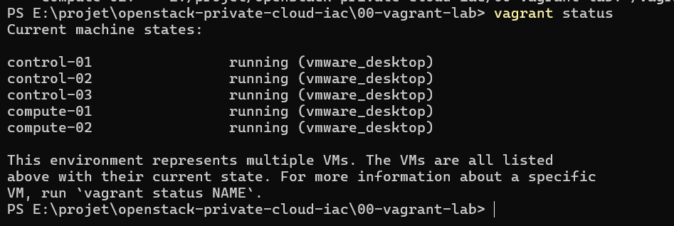

## 1. Première étape :  Environnement de travail

Pour la partie de préparations des machines virtuelles qui vont faire l 'office d'hôte pour **Openstack**, nous avons   préparer un fichier [Vagrantfile](./00-vagrant-lab/Vagrantfile)  qui contient la contigurations  de  ces machine. Au total , nous avons 5 machines qui sont répartie   en  trois (3) machine **controller** et  deux (2) machines **compute**  avec les caractériques suivante :

| **Nom** | **Type** | **RAM** |**CPU** |
| :--- | :--- | :--- | :--- | :--- |
|control-01| controller | 5632 Mo | 2 |
|control-02| controller | 5632 Mo | 2 |
|control-03| controller | 5632 Mo | 2 |
|compute-01| compute    | 4096 Mo | 2 |
|compute-02| compute    | 4096 Mo | 2 |

Avec la commande  `vagrant up` nous créons  ces machies virtuelle: 

